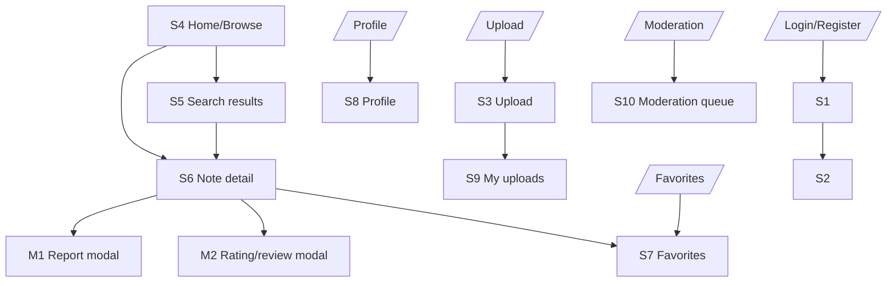

# PRD Template — Student Copy

Oct 27, 2026 · @Melsoft

## How to use this template
A PRD (Product Requirements Document) is the single source of truth for what you are building, who it is for, and how you will know it works.

### Rules for filling it in
1. **Brackets and "e.g." are hints, never answers.** Replace everything inside [square brackets] with your own content.
2. **Delete the guidance when you are done:** the italic *Why this matters* lines and the Tips. Keep the headings, table headers and your own content.
3. **Required, Recommended or Optional.** Every section heading is tagged: Required parts must be completed. Recommended parts should be completed, unless you write one line explaining why not. Optional parts may be deleted.
4. **Never write "N/A" silently.** If something does not apply, write "None in v1" or "Not needed because …".
5. **Be specific and use numbers.**
6. **Use IDs and keep them unique.** F# = feature, BR# = business rule, US# = user story, S# = screen, M# = modal or pop-up, G# = goal, T# = test
7. **Everything must connect.** Every feature has at least one user story. Every user story has at least one screen. Every screen appears in at least one flow.
8. **One word per idea.** Choose your key terms in Section 1.7 and use exactly those words everywhere.
9. **Keep the MVP small:** 3 to 5 Must features, up to 3 Should features, and 6 to 12 full screens. Modals and pop-ups do not count towards the 12.
10. **Plain English.**
11. **Worked example.** Use the worked example as a guide, not as content to copy.

**Document details** (Required)

| Field | Your answer |
|---|---|
| Product name | EduLink |
| Author(s) | Thami Sithole |
| Course code and cohort | AISD - SNPL2026 |
| Facilitator / reviewer | Mnelisi Maswanganyi |
| Link to your original app idea | docs/App Concept Docs/EduLink - App Concept Document.md |
| GitHub repository | https://github.com/ThamiRoneo/EduLink |
| Version | v1.0 |
| Status | Ready for Review/Implementation |

**Change log** (Required)

| Version | Date | Section(s) changed | What changed | Regenerated? (screens / MASTER.md / none) |
|---|---|---|---|---|
| v0.1 | 2026-10-30 | All | First draft from concept document | none |
| v1.0 | 2026-10-30 | All | Completed all sections per template, filled all fields, resolved all items | none |

## 1. Product overview (Required)

**1.1 Product name:** EduLink

**1.2 One-line pitch** (20 words or fewer, in exactly this pattern): EduLink helps South African university students to upload, discover, and review peer notes so that they can find quality course-relevant study material for free.

**1.3 Problem statement** (3 to 5 sentences, at least one number): South African university students rely heavily on fragmented informal channels like WhatsApp groups to access lecture notes and past material. Many commercial platforms gatekeep quality notes behind paywalls or credits, making access inequitable. With limited mobile data budgets and no reliable way to judge note quality, students waste time and money. These barriers make exam preparation harder and exclude students not in the "right" sharing groups.

**1.4 Solution** (3 to 5 sentences): EduLink provides a moderated, searchable repository of student notes where users can upload notes in PDF or DOCX format (max 100MB) with metadata including institution, course/module, year, and tags. Students can browse and filter by those attributes, see view counts, save favorites, rate (1-5 stars), leave short reviews/comments, and report abusive or incorrect notes. All uploads require moderation before becoming visible, ensuring a safer, more trustworthy space for sharing study material.

**1.5 Platform** (choose one):
- Web and mobile

Design and build first: Web-first, with iOS and Android apps for v1.

**1.6 Vision** (Optional, 1 to 2 sentences): Within 2 years, EduLink will become the trusted, student-first notes library for South African universities—accessible, quality-assured through community moderation, and discoverable by course context across most major institutions.

**1.7 Key terms** (Required, 3 to 8 terms): The words your app uses for its main ideas, with one exact meaning each. Use these words, and only these words, everywhere.

| Term | Exact meaning in this app |
|---|---|
| Note | A study document uploaded by a user in PDF or DOCX format. |
| Institution | A South African university or TVET institution. |
| Course/Module | An academic course or module identified by course code/name. |
| Moderation queue | The list of uploads awaiting review before becoming publicly visible. |
| Rating | A 1-5 star rating given by an authenticated user to a note (one per user per note). |
| Review/Comment | A short text feedback (max 500 chars) left by an authenticated user on a note. |
| Favorite | A note saved by an authenticated user to their personal favorites list. |
| Report | A flag submitted by an authenticated user about a note (Abuse, Incorrect/Misleading, Copyright, Other). |

## 2. Users, personas and roles (Required)

**2.1 Primary user:** South African university students (ages 18-25), primarily first through final year, using Android/iOS phones or web on campus with mixed WiFi/mobile data, English plus local languages, tech comfort Medium-High.

**2.2 Secondary users** (Recommended): Moderators and admins who review uploads and reports. None other in v1.

**2.3 Personas** (2 or 3)

| Field | Persona 1 | Persona 2 |
|---|---|---|
| Name and age | Thandi, 19 | Sipho, 23 |
| Role (from 2.4) | User | User |
| Occupation / situation | First-year student at UP | Senior student at UCT |
| Device and connectivity | Android phone, prepaid data, occasional campus WiFi | Android/iOS, mixed data/WiFi |
| Tech comfort | Medium | High |
| Language(s) | English, isiZulu | English, isiXhosa |
| Goal | Find module notes quickly without joining many WhatsApp groups | Share structured notes and get feedback/reputation |
| Frustrations today | Paywalls, can't tell if notes are correct, scattered across groups | Notes lost in groups, no feedback/credit |
| How the app helps | Filter by module/year/institution, ratings/reviews, favorites | Upload PDF/DOCX, get ratings/reviews, visibility by course context |
| Quote | "I just need notes for CSC101 this year that won't cost me data credits or money." | "If I can help someone pass while getting feedback, it's worth uploading." |

**2.4 Roles and permissions.**

| Role | How someone gets this role | Can do | Cannot do |
|---|---|---|---|
| Guest | Unauthenticated visitor | Browse approved notes, view note detail, search/filter | Upload, rate, review, favorite, report, access profile/mod queue |
| User | Registers with email+password (open registration) | All Guest actions + upload notes (goes to pending), rate/review (own), favorite, report, manage profile/favorites/my uploads | Access moderation queue, change roles, approve/reject uploads |
| Moderator | Assigned by Admin | All User actions + access moderation queue, approve/reject uploads with reason, review reports, take moderation actions, view audit info | Manage user roles, system configuration |
| Admin | Assigned initially | All Moderator actions + user role management, system configuration | None in scope for v1 restrictions |

**2.5 Admin** (Required): Admin uses its own screens in the app (list them in Section 8.1 with role restrictions; moderation queue S10 is used by moderators/admins).

## 3. Goals, success metrics and non-goals (Required)

**3.1 Goals**

| # | Goal | Metric (what you count) | Target | How you will check it |
|---|---|---|---|---|
| G1 | Accessibility | % of notes discoverable via filters | >= 80% | Filter usage analytics (count of notes returned via filter queries / total approved notes) |
| G2 | Quality assurance | % of published notes with >=1 rating or review | >= 40% | Count notes with rating_count>=1 or reviews>=1 / total approved notes |
| G3 | Trust/safety | % of reports actioned within 48 hours | >= 90% | (Reports with status resolved/dismissed and actioned within 48h) / total reports * 100 |
| G4 | Adoption | Registered users (SA universities) | >= 1000 in first 3 months (aspirational) | Count of User accounts created |
| G5 | Engagement | Avg favorites per active user | >= 2 | (Total favorites) / (active users in period) |
| G6 | Content growth | Moderated notes across institutions | >= 500 notes across >= 10 institutions | Count approved notes grouped by institution |

**3.2 Non-goals**

| Non-goal | Why not in v1 |
|---|---|
| Paywalls/subscriptions/credits | Student-first; free in v1 |
| Full document editor/annotations | Focus on sharing/discovery, not editing |
| AI summary/chat over notes | Out of scope for v1 complexity |
| User-to-user messaging/chat | Avoid moderation complexity |
| General social feed | Notes-focused experience |
| File types beyond PDF/DOCX | Defined scope for v1 |
| Bulk scraping/import | Manual/community-driven in v1 |
| Multi-language UI translation | English-first in v1 |

## 4. Features, business rules and notifications (Required)

**4.1 Feature list**

| ID | Feature name | What the user can do (list every action) | Priority | Goal (G#) | Stories (US#) | Screens (S#) |
|---|---|---|---|---|---|---|
| F1 | Auth (register/login) | Register with email+password, login/logout, flag .ac.za emails, role-based access | Must | G4 | US1 | S1, S2, S8 |
| F2 | Upload notes (PDF/DOCX) | Upload file (PDF/DOCX, max 100MB) with title, institution, course/module, year, tags; submit to pending queue | Must | G6 | US2 | S3, S9 |
| F3 | Moderation queue | View pending uploads, preview/download, approve with audit log, reject with required reason, review reports | Must | G3,G6 | US6 | S10 |
| F4 | Browse & search/filter | Browse home/list, search by keyword, filter by institution, course/module, year, tags; combine filters | Must | G1 | US3 | S4, S5, S6 |
| F5 | Note detail | View metadata, file info, ratings summary, reviews, view count, download/view, show actions by auth state | Must | G1,G2 | US3,US4,US5 | S6 |
| F6 | Ratings (1-5) | Authenticated users rate note 1-5 (one per user per note); update own rating; disallow self-rating | Must | G2 | US4 | S6, M2 |
| F7 | Reviews/comments (short) | Authenticated users leave short review (max 500 chars); view reviews list | Must | G2 | US4 | S6, M2 |
| F8 | Reports | Authenticated users report note with category (Abuse/Incorrect-Misleading/Copyright/Other) and details | Must | G3 | US5 | S6, M1 |
| F9 | View count | Increment view count on note view with deduplication (user/session) | Must | G1 | US3 | S4, S5, S6 |
| F10 | Favorites | Authenticated users toggle favorite; view favorites list; remove favorite | Must | G5 | US7 | S6, S7, S8 |
| F11 | User profile | View profile, see user's uploads and favorites tabs | Should | G5 | US1, US7 | S8 |
| F12 | Browse by institution/course | Navigate by institution then course/module for discoverability | Should | G1 | US3 | S4 |
| F13 | My uploads/status | Track uploads with status (pending/approved/rejected) and show rejection reason | Should | G6 | US2 | S9 |

**4.2 MVP definition** (one sentence): The smallest version that solves the core problem is EduLink with auth, upload (PDF/DOCX, max 100MB), moderation before publication, browse/filter by institution/course/module/year/tags, note detail, ratings, short reviews, reports, view counts, and favorites.

**4.3 Future features** (Optional)

- AI summary of notes
- In-app user messaging
- Download analytics for uploaders
- Institution verification for .ac.za emails
- Collections/playlists of notes

**4.4 Business rules**

| ID | Rule (exact logic, numbers and limits) | Used by (F#, S#) |
|---|---|---|
| BR1 | File types allowed: only .pdf and .docx. Any other extension or MIME type must be rejected. | F2, S3 |
| BR2 | File size limit: maximum 100MB per upload. Files over 100MB must be rejected with a clear error. | F2, S3 |
| BR3 | Moderation required: all uploads start in status pending. Only notes with status approved are publicly visible. | F2, F3, S3, S6, S9, S10 |
| BR4 | Visibility: rejected notes are visible only to the uploader and moderators with rejection_reason shown. Pending notes visible only to uploader and moderators. | F2, F3, S6, S9, S10 |
| BR5 | Ratings: 1-5 stars only. One rating per (user_id, note_id). Authenticated users only. Users may update their own rating. Self-rating is disallowed. | F6, S6, M2 |
| BR6 | Reviews: short text only, maximum 500 characters. Authenticated users only. | F7, S6, M2 |
| BR7 | Reports: authenticated users only. Must select category (Abuse, Incorrect/Misleading, Copyright, Other). Reports go to moderation queue with status open. | F8, S6, M1, S10 |
| BR8 | View count: increment on note detail view with deduplication by user/session to avoid inflation. | F9, S4, S5, S6 |
| BR9 | Favorites: authenticated users only. Unique (user_id, note_id). Toggle to add/remove. | F10, S6, S7, S8 |
| BR10 | Auth: open registration with email+password. Flag emails ending with .ac.za (no hard gate in v1). | F1, S1, S2 |
| BR11 | RBAC: roles Guest/User/Moderator/Admin enforced on protected routes and actions. Only Moderator/Admin can access moderation queue. | F1, F3, S1, S10 |
| BR12 | Rate limits: sensible rate limits applied to auth, upload, and report endpoints. | F1, F2, F8, S1, S2, S3, M1 |
| BR13 | Self-rating disallowed: if user_id == uploader_id, rating action must be prevented with message. | F6, S6, M2 |

**4.5 Notifications** (Required)

| Trigger | Who receives it | Channel (in-app / push / email / SMS) | Exact text | Tapping it opens |
|---|---|---|---|---|
| Upload approved (moderator approves pending note) | Uploader (User) | in-app | "Your note '[title]' has been approved and is now visible on EduLink." | S9 (My uploads) or S6 (Note detail) |
| Upload rejected (moderator rejects with reason) | Uploader (User) | in-app | "Your note '[title]' was rejected. Reason: [reason]." | S9 (My uploads) |
| Report submitted (user submits report) | Reporter (User) | in-app | "Thanks for reporting. We'll review it." | S6 (Note detail) |

## 5. Accounts and sign-in (Required)

| Decision | Your answer |
|---|---|
| Do you need accounts? | Yes - accounts required for upload, rate, review, favorite, report. Browse is possible as Guest. |
| Sign-up method(s) | Email + password (open registration) |
| Log-in method(s) | Email + password |
| Email verification? (yes/no + details) | No in v1 (can add later). Flag .ac.za emails for prioritization/statistics. |
| Password rules (exact) | Minimum 8 characters. Show inline validation errors. |
| Username/display name rules | Display name required on registration (min 2 chars). |
| Age gate? (yes/no + rule) | No explicit age gate in v1; follow general terms. |
| Roles in v1 (list exactly) | Guest, User, Moderator, Admin |
| What can a logged-out user do? | Browse approved notes, view note detail, search/filter. Cannot upload/rate/review/favorite/report. |
| What must be logged-in to do? | Upload, rate, review, favorite, report, access profile/favorites/my uploads. |
| Session / "remember me"? | Standard session persistence on device (remember me optional). |
| "Forgot password"? | Recommended for v1 (basic flow). |
| Account deletion? | Not required in v1 - None. |
| Anything else? | Flag .ac.za emails; RBAC enforced server-side. |

## 6. User stories, acceptance criteria and edge cases (Required)

**Rules**
- Every Must and Should feature has at least one story.
- Every story has 2-4 acceptance criteria (AC#), written as Given / When / Then.
- Include at least one unhappy path per story where it makes sense.
- Test IDs are T# and linked to criteria.

### 6.1 Stories

| ID | User story (As a / I want / so that) | Feature (F#) | Screens (S#) | Priority |
|---|---|---|---|---|
| US1 | As a guest/user, I want to register/login and manage my profile so that I can access protected features. | F1, F11 | S1, S2, S8 | Must |
| US2 | As a logged-in user, I want to upload a PDF/DOCX (<=100MB) with metadata so that I can share notes. | F2, F13 | S3, S9 | Must |
| US3 | As any user, I want to browse/filter by institution/course/module/year/tags and search so that I can find relevant notes quickly. | F4, F9, F12 | S4, S5, S6 | Must |
| US4 | As a logged-in user, I want to rate (1-5) and leave a short review so that I can signal quality and help others. | F6, F7 | S6, M2 | Must |
| US5 | As a logged-in user, I want to report abusive/incorrect notes so that I can help keep content safe and accurate. | F8 | S6, M1 | Must |
| US6 | As a moderator/admin, I want to approve/reject pending uploads with a reason so that only appropriate notes become visible. | F3 | S10 | Must |
| US7 | As a logged-in user, I want to favorite notes and view my favorites so that I can save notes for later. | F10, F11 | S6, S7, S8 | Must |

### 6.2 Acceptance criteria

| AC ID | Story (US#) | Test (T#) | Given / When / Then |
|---|---|---|---|
| AC1.1 | US1 | T1 | Given I am a guest, When I register with valid email+password and display name, Then my account is created and I am logged in. |
| AC1.2 | US1 | T2 | Given I am logged out, When I try to upload, Then I am prompted to login. |
| AC1.3 | US1 | T3 | Given I register with a .ac.za email, When account is created, Then email is flagged as .ac.za (visible to system). |
| AC2.1 | US2 | T4 | Given I am logged in, When I upload a PDF/DOCX under 100MB with required metadata, Then upload is submitted with status pending and appears in My uploads. |
| AC2.2 | US2 | T5 | Given I am logged in, When I upload a file over 100MB or wrong type, Then I see a clear validation error and upload is not submitted. |
| AC2.3 | US2 | T6 | Given my upload is rejected, When I view My uploads, Then I see status rejected with rejection reason. |
| AC3.1 | US3 | T7 | Given approved notes exist, When I filter by institution/course/module/year/tags, Then results update to match filters. |
| AC3.2 | US3 | T8 | Given I apply filters with no results, When results load, Then I see empty state "No notes match your filters." |
| AC3.3 | US3 | T9 | Given I view a note detail, When page loads, Then view count increments (with deduplication). |
| AC4.1 | US4 | T10 | Given I am logged in and not the uploader, When I rate 1-5 and submit, Then rating is saved (one per user). |
| AC4.2 | US4 | T11 | Given I am the uploader, When I try to rate my own note, Then action is prevented with message. |
| AC4.3 | US4 | T12 | Given I am logged in, When I add a review over 500 chars, Then I see validation error (max 500). |
| AC5.1 | US5 | T13 | Given I am logged in, When I report with a category, Then report is submitted and I see confirmation toast. |
| AC5.2 | US5 | T14 | Given I am not logged in, When I try to report, Then I am prompted to login. |
| AC6.1 | US6 | T15 | Given I am a moderator, When I approve a pending note, Then status becomes approved and note becomes publicly visible. |
| AC6.2 | US6 | T16 | Given I am a moderator, When I reject without reason, Then I cannot reject (reason required). |
| AC6.3 | US6 | T17 | Given I am not a moderator, When I try to access moderation queue, Then access is denied. |
| AC7.1 | US7 | T18 | Given I am logged in, When I toggle favorite on a note, Then it is added/removed and appears/disappears in Favorites. |
| AC7.2 | US7 | T19 | Given I am not logged in, When I try to favorite, Then I am prompted to login. |

### 6.3 Edge cases (at least 5)

| EC ID | Edge case | Expected behaviour | Linked (US#/BR#) |
|---|---|---|---|
| EC1 | Corrupted/invalid file uploaded | Reject with clear error; do not create pending note | US2, BR1, BR2 |
| EC2 | Duplicate file content uploaded | Allow as new upload (moderation still required); no automatic blocking in v1 | US2, BR3 |
| EC3 | User rates their own note | Prevent action with message; rating not created/updated | US4, BR5, BR13 |
| EC4 | Upload near 100MB or slow connection | Enforce size limit client+server; show progress/errors clearly | US2, BR2 |
| EC5 | Missing required metadata on upload | Form validation prevents submit with specific field errors | US2, BR1, BR2, BR3 |
| EC6 | Rapid repeated reports | Rate-limited; show appropriate message | US5, BR7, BR12 |
| EC7 | Note rejected then re-uploaded | New upload treated as separate pending item with its own status | US2, BR3, BR4 |
| EC8 | View count inflation | Deduplicated by user/session; count only on valid view events | US3, BR8 |

## 7. User flows and navigation map (Required)

### 7.1 Flows (at least one per Must feature)

| Flow ID | Name | Goal | Steps (numbered) | Screens/modals (S#/M#) | Feature (F#) |
|---|---|---|---|---|---|
| FL1 | Discover notes | Find relevant notes | 1) Go to Home/Browse 2) Apply filters/search 3) View results 4) Open note detail | S4, S5, S6 | F4, F9, F12 |
| FL2 | Upload and moderate | Share a note | 1) Login 2) Go to Upload 3) Fill metadata + select file (PDF/DOCX,<=100MB) 4) Submit (pending) 5) Moderator reviews in queue 6) Approve/reject with reason 7) Uploader sees status/notification | S1, S3, S9, S10 | F1, F2, F3 |
| FL3 | Engage with note | Rate, review, favorite, report | 1) Open note detail 2) Rate/review (if logged in) 3) Favorite (if logged in) 4) Report if needed (modal) | S6, M1, M2 | F5, F6, F7, F8, F10 |
| FL4 | Manage favorites/profile | Save and track notes | 1) Login 2) Favorite from detail/card 3) View Favorites/Profile/My uploads | S1, S6, S7, S8, S9 | F1, F10, F11, F13 |

### 7.2 Navigation map (Mermaid)



### 7.3 Access rules for navigation
| Route/area | Who can access | Behaviour if not allowed |
|---|---|---|
| S1,S2 (Auth) | Guest/User/Mod/Admin | Show forms; redirect after login |
| S3 (Upload) | User/Mod/Admin | If guest -> redirect to S1 |
| S4,S5,S6 (Browse/detail) | Guest/User/Mod/Admin | Public for approved notes |
| S7 (Favorites) | User/Mod/Admin | If guest -> redirect to S1 |
| S8 (Profile) | User/Mod/Admin | If guest -> redirect to S1 |
| S9 (My uploads) | User/Mod/Admin | If guest -> redirect to S1 |
| S10 (Moderation queue) | Moderator/Admin only | If not mod/admin -> 403/redirect with message |

## 8. Screens (Required)

### 8.1 Screen list (6 to 12 full screens; modals don't count)

| ID | Screen name (exact, use everywhere) | Purpose (1 sentence) | Primary user(s) | Key actions | Features (F#) | Linked stories (US#) |
|---|---|---|---|---|---|---|
| S1 | Login | Authenticate existing users with email+password. | Guest/User | Enter email/password, login, go to Register | F1 | US1 |
| S2 | Register | Create new account with email+password and display name. | Guest | Enter details, register, go to Login; show .ac.za hint | F1 | US1 |
| S3 | Upload | Upload PDF/DOCX note with metadata to moderation queue. | User/Mod/Admin | Select file, fill metadata, validate (type/size), submit | F2 | US2 |
| S4 | Home/Browse | Discover notes with filters and navigation. | Guest/User/Mod/Admin | Browse, filter by institution/course/module/year/tags, search, open note | F4, F9, F12 | US3 |
| S5 | Search results | Show filtered/search results with active filters. | Guest/User/Mod/Admin | Refine filters, clear filters, open note | F4, F9 | US3 |
| S6 | Note detail | View note details, ratings/reviews, actions (rate/review/favorite/report/download). | Guest/User/Mod/Admin | Rate/review (auth), favorite (auth), report (auth), download/view | F5, F6, F7, F8, F9, F10 | US3,US4,US5 |
| S7 | Favorites | Show saved favorite notes. | User/Mod/Admin | Remove favorite, open note | F10 | US7 |
| S8 | Profile | Show user profile and tabs for uploads/favorites. | User/Mod/Admin | View info, switch tabs, navigate | F1, F11 | US1,US7 |
| S9 | My uploads | Track user's uploads with status and rejection reason. | User/Mod/Admin | View status, see reason if rejected, open related note if approved | F2, F13 | US2 |
| S10 | Moderation queue | Review pending uploads and reports for approval/rejection. | Moderator/Admin | Preview/download, approve, reject with reason, review reports | F3, F8 | US6 |

### 8.2 Screen states (every screen)

| Screen (S#) | Normal state | Empty state | Loading state | Error state | Offline state | Success state | Notes / exact messages |
|---|---|---|---|---|---|---|---|
| S1 Login | Login form with email/password, Login button, link to Register | Not needed because form is present | "Signing in..." button disabled, spinner | "Invalid email or password." / field errors | "You're offline. Check your connection." | Redirect to previous page or Home on success | Enforce BR10,BR11 |
| S2 Register | Registration form with email/password/display name, Register button | Not needed | "Creating account..." disabled | Show field errors; "Email already in use." if duplicate | "You're offline. Check your connection." | "Account created. Please log in." or auto-login; redirect | Show .ac.za hint; BR10 |
| S3 Upload | Upload form with file picker, metadata fields, Submit button | Not needed | "Uploading..." with progress | "File must be PDF or DOCX." / "File too large (max 100MB)." / "Please fill all required fields." | "You're offline. Cannot upload." | "Upload submitted. Pending moderation." then redirect to S9 | Enforce BR1,BR2,BR3 |
| S4 Home/Browse | Filter panel + note cards grid | "No notes yet. Be the first to upload." | Skeleton cards/loading filters | "Couldn't load notes. Try again." with retry | "Showing cached results if available." or message | N/A | Use C1,C2; BR8,BR9 |
| S5 Search results | Active filters + results grid | "No notes match your filters." with Clear filters | Loading results | "Couldn't load results. Try again." | "Showing cached results if available." | N/A | Combine filters (AND) |
| S6 Note detail | Metadata, ratings summary, reviews, actions bar | N/A if note exists; else handled by error | Loading detail | "Couldn't load note. Try again." | "Limited info. Some actions unavailable." | Toasts for rate/fav/report | Respect BR4,BR5,BR6,BR7,BR8,BR9,BR13 |
| S7 Favorites | Favorites grid/list | "You have no favorites yet." with Browse link | Loading favorites | "Couldn't load favorites. Try again." | "Favorites may not sync offline." | "Removed from favorites." toast | Auth required BR9 |
| S8 Profile | Profile info + tabs (Uploads/Favorites) | "No uploads yet." / "No favorites yet." per tab | Loading profile/data | "Couldn't load profile. Try again." | "Limited profile data offline." | N/A | BR1,F11 |
| S9 My uploads | List with StatusBadge and details | "You haven't uploaded any notes yet." with Upload link | Loading uploads | "Couldn't load uploads. Try again." | "Status may be outdated offline." | N/A | Show rejection_reason per BR4 |
| S10 Moderation queue | Pending list with preview/actions | "No pending items." | Loading queue | "Couldn't load queue. Try again." | "Queue unavailable offline." | "Note approved." / "Note rejected." toasts | RBAC enforced BR11 |

### 8.3 Modals/pop-ups (M#) (if any)

| ID | Modal name | Trigger (which screen/action) | Purpose | Fields/actions | Validation/errors | Closes on |
|---|---|---|---|---|---|---|
| M1 | Report modal | S6 -> "Report" button (auth required) | Report abusive/incorrect note | Category dropdown (Abuse, Incorrect/Misleading, Copyright, Other), details textarea (optional), Submit/Cancel | Category required; if guest redirect to login | Submit success (toast) or Cancel |
| M2 | Rating/review modal | S6 -> "Rate/Review" button (auth required, not uploader) | Submit rating and/or short review | Stars 1-5 (required for rating), review textarea (max 500 chars), Submit/Cancel | Stars required to rate; review max 500; prevent self-rating (BR13) | Submit success or Cancel |

### 8.4 Shared components (reusable)

| Component ID | Name | Purpose | Variants/states | Used on (S#/M#) | Props/notes |
|---|---|---|---|---|---|
| C1 | NoteCard | Display note summary | default, compact | S4, S5, S7 | title, institution, course/module, year, rating, view_count, favorite state |
| C2 | FilterPanel | Filters for browse/search | desktop, mobile (collapsible) | S4, S5 | institution, course/module, year, tags; emits filter changes |
| C3 | FileUploader | File picker with validation | default, error | S3 | accept .pdf,.docx; max 100MB; shows type/size errors |
| C4 | RatingStars | Star rating display/input | display, input (1-5) | S6, M2 | readonly or interactive; supports half? no, integer 1-5 |
| C5 | ReviewList | List of short reviews | default, empty | S6 | shows author, content (<=500), date |
| C6 | ReportButton | Trigger report modal | default, disabled (guest) | S6 | shows login prompt if guest |
| C7 | FavoriteButton | Toggle favorite | default, active, disabled (guest) | S6, C1 | toggles favorite state |
| C8 | StatusBadge | Upload status indicator | pending/approved/rejected | S9, S10 | shows status and color per BR4 |
| C9 | AuthForm | Login/register form | login, register | S1, S2 | shared validation, .ac.za hint |
| C10 | EmptyState | Consistent empty messaging | default | S4,S5,S7,S9,S10 | message + optional CTA |
| C11 | Toast/Notification | Feedback messages | success,error,info | Global | auto-dismiss for success/info |

## 9. Design direction (Required)

### 9.1 Look and brand
| Item | Your answer (exact) |
|---|---|
| Style words (2-3) | Clean, student-friendly, trustworthy |
| Primary colour (hex) | #1F4E79 |
| Secondary colour (hex) | #3B82F6 |
| Accent/CTA colour (hex) | #1F4E79 (primary for CTAs) |
| Background colour (hex) | #FFFFFF |
| Surface/card colour (hex) | #F7F9FC |
| Text colour (hex) | #1A1A1A |
| Subtext colour (hex) | #4F4F4F |
| Error/warning/success (hex) | #DC2626 / #F59E0B / #22C55E |
| Border colour (hex) | #E5E7EB |
| Logo idea (description) | "EduLink" wordmark; simple, readable, academic feel |

### 9.2 Typography and spacing
| Item | Your answer (exact) |
|---|---|
| Font(s) for headings | Inter, system-ui, -apple-system, sans-serif |
| Font(s) for body | Inter, system-ui, -apple-system, sans-serif |
| Base font size (px/rem) | 16px (1rem) |
| Scale (e.g. 12/14/16/20/24/32) | 12px, 14px, 16px, 20px, 24px, 32px |
| Spacing scale (use 4pt) | 4, 8, 12, 16, 24, 32, 48 px |
| Border radius (px) | 8px (cards/inputs), 4px (badges) |
| Shadows/elevation | Subtle shadow: 0 1px 3px rgba(0,0,0,0.1) for cards |

### 9.3 Platform rules
| Item | Your answer |
|---|---|
| Mobile first? | Yes - design mobile first, responsive to desktop |
| Touch targets (min px) | >= 44x44 px for tappable elements |
| Safe areas/notches? | Respect safe areas on iOS/Android |
| Dark mode? | No in v1 (light mode only) |
| Accessibility basics | Sufficient color contrast (aim >= 4.5:1), alt text where relevant, keyboard navigable forms |

**Design tokens summary (use these everywhere):** Primary #1F4E79, BG #FFFFFF, Surface #F7F9FC, Text #1A1A1A, Subtext #4F4F4F, Border #E5E7EB, Success #22C55E, Warning #F59E0B, Danger #DC2626, Font Inter/system, 4pt spacing scale.

## 10. Data model (Required)

### 10.1 Entities and fields

| Entity | Purpose | Fields (name, type, required?, notes/constraints) | Relations |
|---|---|---|---|
| User | Registered user account | id (UUID, PK, req), email (string, unique, req), password_hash (string, req), display_name (string, req), role (enum: guest/user/mod/admin, req), institution_affiliation (string, opt), email_flag_acza (bool, default false), created_at (timestamp, req), updated_at (timestamp, req) | has many Note, Rating, Review, Favorite, Report |
| Note | Uploaded study document | id (UUID, PK, req), uploader_id (UUID, FK->User, req), title (string, req), institution (string, req), course_code (string, req), course_name (string, req), year (int/string, req), tags (json/array, req), file_type (enum: pdf/docx, req), file_url/storage_key (string, req), file_size (int bytes, req, <=100MB), status (enum: pending/approved/rejected, req), rejection_reason (text, opt), view_count (int, default 0), avg_rating (decimal, default 0), rating_count (int, default 0), created_at (timestamp, req), updated_at (timestamp, req), approved_at (timestamp, opt), approved_by (UUID, FK->User, opt) | belongs to User; has many Rating, Review, Favorite, Report, ViewEvent |
| Rating | User rating of note | id (UUID, PK, req), note_id (UUID, FK->Note, req), user_id (UUID, FK->User, req), stars (int, req, 1-5), created_at (timestamp, req), updated_at (timestamp, req) | belongs to Note, User. Unique (note_id,user_id). BR5,BR13 |
| Review | Short review/comment | id (UUID, PK, req), note_id (UUID, FK->Note, req), user_id (UUID, FK->User, req), content (varchar(500), req), created_at (timestamp, req), updated_at (timestamp, req) | belongs to Note, User. BR6 |
| Favorite | User saved note | id (UUID, PK, req), user_id (UUID, FK->User, req), note_id (UUID, FK->Note, req), created_at (timestamp, req) | belongs to User, Note. Unique (user_id,note_id). BR9 |
| Report | User report of note | id (UUID, PK, req), note_id (UUID, FK->Note, req), reporter_id (UUID, FK->User, req), category (enum: Abuse/Incorrect-Misleading/Copyright/Other, req), details (text, opt), status (enum: open/resolved/dismissed, req, default open), resolved_by (UUID, FK->User, opt), resolved_at (timestamp, opt), created_at (timestamp, req) | belongs to Note, User. BR7 |
| ViewEvent | View tracking for deduplication | id (UUID, PK, req), note_id (UUID, FK->Note, req), user_id (UUID, FK->User, opt), ip_hash (string, opt), viewed_at (timestamp, req) | belongs to Note. BR8 |

### 10.2 Status values
| Entity | Status field | Values | Rules |
|---|---|---|---|
| Note | status | pending, approved, rejected | pending->approved or pending->rejected by moderator; only approved public. BR3,BR4 |
| Report | status | open, resolved, dismissed | open by default; updated by moderator/admin on action. BR7 |

### 10.3 Choices for dropdowns/radios
| Field | Choices (exact) | Notes |
|---|---|---|
| User.role | guest, user, moderator, admin | BR11 |
| Note.file_type | pdf, docx | BR1 |
| Note.status | pending, approved, rejected | BR3,BR4 |
| Report.category | Abuse, Incorrect/Misleading, Copyright, Other | BR7 |
| Report.status | open, resolved, dismissed | BR7 |

### 10.4 Reference and seed data
| What | Details |
|---|---|
| Reference data | SA universities list (for institution dropdown), common course prefixes/tags (optional), year options |
| Seed data | At least 2-3 approved sample notes across different institutions/courses for demo/testing; 1 moderator user for testing |

## 11. Tech stack and architecture (Required)

### 11.1 Stack (with versions if known)
| Layer | Choice | Version (if known) | Reason |
|---|---|---|---|
| Frontend (Web) | Next.js / React | Latest stable | Web-first, responsive, easy for cross-platform later |
| Mobile | React Native / Expo (or Flutter) | Latest stable | Share logic where possible for iOS/Android v1 |
| Backend/API | Next.js API routes or Node/Express | Latest stable | RESTful APIs for auth, uploads, moderation |
| Database | PostgreSQL | 15+ | Relational fits entities/relations/filters |
| Auth | Email+password (custom) | N/A | Simple, open registration |
| File storage | Object storage (S3-compatible/R2) | N/A | Store PDF/DOCX with signed URLs, 100MB support |
| Hosting | Vercel/Render/Railway + storage/CDN | N/A | Deployable for web + API |

### 11.2 Architecture notes
- Client calls API; server enforces auth/RBAC, validation (type/size), moderation rules.
- Files stored in object storage; DB stores metadata and status.
- Only approved notes returned for public listing.
- Server-side checks for BR13 (self-rating), BR5 (one rating), etc.

### 11.3 Environment variables (list all)
| Name | Purpose | Example | Required? |
|---|---|---|---|
| DATABASE_URL | Postgres connection string | postgres://... | Yes |
| STORAGE_BUCKET | Object storage bucket name | edulink-uploads | Yes |
| STORAGE_KEY/SECRET | Storage credentials | ... | Yes |
| JWT_SECRET or SESSION_SECRET | Auth session/token secret | ... | Yes |
| NEXT_PUBLIC_APP_URL | App base URL | https://... | Yes |

### 11.4 Folder structure (suggested)
```
/app or /src
  /components (shared components C1-C11)
  /pages or /app routes (S1-S10)
  /api (auth, upload, notes, ratings, reviews, reports, moderation)
  /lib (db, auth, storage, validation)
/prisma or /migrations
/public
/docs (this PRD and concept doc)
```

## 12. Testing plan (Required)

### 12.1 Test types
| Type | What to test | Tool (suggested) |
|---|---|---|
| Unit | Validation (file type/size), helpers, RBAC checks | Jest/Vitest |
| Integration | Upload flow, moderation flow, ratings/favorites/reports | Jest/Vitest + test DB |
| E2E | Critical flows FL1-FL4 | Playwright/Cypress |
| Manual | States per screen, mobile responsiveness | Browser/device testing |

### 12.2 Key tests (link to T#)
| Test ID | Scenario | Expected | Type |
|---|---|---|---|
| T1 | Register new user | Account created, logged in | Integration |
| T4 | Upload valid PDF under 100MB | Pending in My uploads | Integration |
| T5 | Upload wrong type/oversize | Validation error, no upload | Integration |
| T15 | Moderator approves pending | Becomes approved/public | Integration |
| T16 | Moderator rejects without reason | Cannot reject | Integration |
| T10 | Rate note (not own) | Rating saved | Integration |
| T11 | Self-rating attempt | Blocked with message | Integration |
| T13 | Submit report | Report created, toast shown | Integration |
| T18 | Toggle favorite | Added/removed from favorites | Integration |

## 13. Implementation checklist and open questions (Required)

### 13.1 Pre-build checklist
- [x] All sections completed per template
- [x] IDs unique (F1-F13, BR1-BR13, US1-US7, S1-S10, M1-M2, G1-G6, T1-T19, AC1-AC7, EC1-EC8)
- [x] Every Must feature has stories and screens
- [x] All screens have states defined
- [x] All modals defined
- [x] Shared components listed
- [x] Design tokens with hex codes
- [x] Data model complete
- [x] Business rules explicit
- [x] Flows and navigation map complete
- [x] RBAC and permissions defined
- [x] File validation rules (PDF/DOCX, 100MB) enforced
- [x] Moderation required before visibility
- [x] Ratings/reviews/reports/favorites/view counts specified

### 13.2 Definition of Done (DoD)
A feature is done when: implemented per spec, validation passes, states handled, connected to correct screens/flows, tested against acceptance criteria, and follows design tokens/RBAC rules.

### 13.3 Open questions
**None in v1.** All items have been resolved from the concept document and template requirements.

## 14. Milestones (Recommended)
| Milestone | Date (target) | Tasks | Done when |
|---|---|---|---|
| M1: Setup | 2026-11-01 | Repo, DB schema, auth scaffold | Auth works, schema migrated |
| M2: Core upload+moderation | 2026-11-08 | Upload, moderation queue, browse/filter | Upload to pending, moderator can approve/reject, approved visible |
| M3: Engagement+safety | 2026-11-15 | Ratings, reviews, favorites, reports, view counts | All engagement features working with rules enforced |
| M4: Cross-platform polish | 2026-11-22 | Web responsive + mobile builds, states/polish | Web and mobile apps functional for v1 |
| M5: Beta | 2026-11-29 | Pilot with SA universities, fixes | >= feedback collected, stable for pilot |

## 15. Handover notes for AI coding assistant (Recommended)
- Follow this PRD exactly as source of truth. Do not add features beyond MVP without updating PRD.
- Enforce BR1,BR2 (file type/size), BR3,BR4 (moderation/visibility), BR5,BR13 (ratings), BR7 (reports), BR11 (RBAC).
- Use exact IDs everywhere.
- Implement all states for each screen (S1-S10).
- Use design tokens from Section 9.
- Only approved notes are public; pending/rejected restricted as specified.
- One rating per (user,note), disallow self-rating.

## 16. Glossary
| Term | Plain-English meaning |
|---|---|
| Acceptance criteria | Exact checks that prove a feature works, written as Given/When/Then. |
| API | Way programs communicate to request data/actions. |
| Business rule | Rule/limit/calculation the app follows (e.g., max 100MB, moderation required). |
| Edge case | Unusual situation the app must handle. |
| Entity | Thing the app stores (e.g., User, Note). |
| Modal | Pop-up on top of screen (e.g., Report, Rating/review). |
| MVP | Minimum Viable Product solving the core problem. |
| Persona | Realistic imaginary user representing a type. |
| RBAC | Role-Based Access Control limiting actions by role. |
| State (screen) | How screen looks in situation (normal/empty/loading/error/offline/success). |
| Toast | Short message that appears briefly. |
| User story | Feature from user's view: As a... I want... so that.... |
